<h1 align="center">
  
</h1>

Checks changed code and docs against a repo's house rules that no linter can check, by asking [TypeSafe](https://typesafe.ai)'s Jev whether each changed piece holds each rule.

A rule is a trait: a folder in `.agents/traits/` with a `TRAIT.md` saying what it expects, plus `pass/` and `fail/` cases that test the wording. traitor sends each changed snippet, with the traits whose `paths` match it, to Jev, and gets back pass, fail, n/a or unsure, with the probability of each.

## Install

Pin it in the repo, so the agent, the Stop hook and CI all run the same traitor:

```sh
bun add --dev @jliocsar/traitor
# or
npm install --save-dev @jliocsar/traitor
```

Each GitHub release also carries the binaries, for a repo without a `package.json`.

## Use

```sh
traitor init           # writes .agents/traitor.json
traitor test [trait…]  # judges each trait's cases
traitor check [rev]    # judges what changed: everything unpushed, since a ref, or A..B
```

`traitor init` is how a repo agrees to send its code to TypeSafe: every `check` and `test` sends snippets there. Committing `.agents/traitor.json` makes that choice visible to everyone on the repo. Set `TYPESAFE_API_KEY` in the environment.

A trait with no `threshold` in `.agents/traitor.json` is only reported. With one, `check` exits 1 when a snippet's p(fail) reaches it. Exit 2 means traitor couldn't check.

## Claude Code

```sh
claude plugin marketplace add jliocsar/traitor
claude plugin install traitor@traitor
```

The plugin adds a `traits` skill, which offers a trait when a correction sounds like a house rule, writes it once you agree, and tests it. It also adds a Stop hook that runs `traitor check` when Claude finishes a turn, and sends it back to fix any fails over a threshold.

## Docs

`CONTEXT.md` is the glossary, `docs/adr/` holds the decisions, and `docs/v1-scope.md` the smaller ones.
